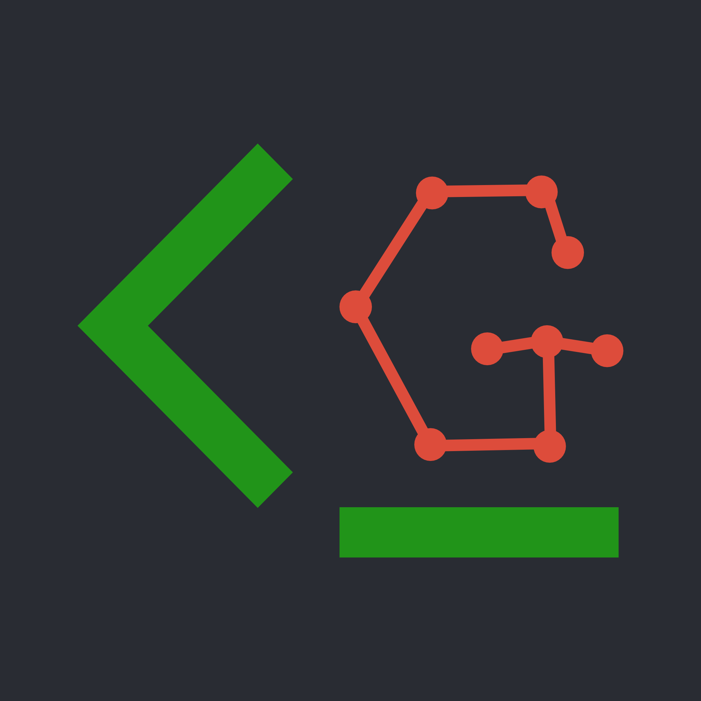

# [](https://github.com/adnathanail/clonager) clonager

**🚨 This tool was created with AI 🚨**

✨ The missing link for [NixOS](https://nixos.org) and [nix-darwin](https://github.com/nix-darwin/nix-darwin) ✨

Once you've got your software and OS config managed through Nix, the final gap between you and complete device statelessness is your data.

For me, the only files stored directly on my device live in git repositories, synced off-machine, but sometimes I forget to commit or push, and getting everything cloned into its proper home is annoying on a fresh OS install. This is where `clonager` comes in!

`clonager` keeps track of your repos' statuses, with their locations managed in a config file. A single command shows you any repos with uncommitted files, unpushed commits, and any stashes. Also, with a single command, it will clone everything into the locations defined in the config, so you can hit the ground running on a new machine.

```
$ cg
~/Documents/Projects
  23m ● your-cool-blog  ⧓ new-post  1 stash · 2 local-only branches

~/Documents/Work
   5d ● work-stuff      main        5 branches deleted on remote · 26 branches merged · 1 branch behind

4 repos · 2 ok (-a to show) · 2 need attention
```

## Features

- Auto-discover repos in a given directory, and write them to the config file
- Show 'local-only' data:
    - un-committed changes
    - un-pushed commits
    - stashes
- Show 'redundant' data that you can delete:
    - local branches already merged
    - remote branches already merged
    - remote links to now dead branches
- Delete redundant data ([Read only](#read-only))
- 'Airlift' the names of your current local branches, checking all local data has been removed, and clone repos (and airlifted branches) onto a new machine ([Read only](#read-only))
- Links to open repos in your desired tool (e.g. VSCode)
- Integration with GitButler CLI (`but`)
    - Show applied branches
    - Show conflicted commits
    - Open in GitButler
- Integration with GitHub CLI (`gh`)
    - Check merge status of branches
- Nix flake for easy install

### Read only

Because this tool was created with AI, and is interacting with critical data, it does not execute any commands which modify your files by itself, except for `clonager`'s own config file. The allowed commands and subcommands are defined in [cli.go](./internal/cli/cli.go).

Functionality which needs to modify your files, like deleting branches and cloning, will just print the necessary commands to the terminal, for you to check and run yourself.

If you want to allow it to run commands unchecked, you can just pipe its output into the shell:

```shell
clonager clone | sh
```

## Install

### With Nix

clonager is available as a Nix flake. Try it with:

```sh
nix run github:adnathanail/clonager          # latest commit on main
nix run github:adnathanail/clonager/v0.5.3   # a release
```

Or install it, and its config, with the Home Manager module (standalone, or
within nix-darwin):

```nix
# flake.nix
inputs.clonager.url = "github:adnathanail/clonager";

# a Home Manager module (with inputs passed through)
{ config, inputs, ... }: {
  imports = [ inputs.clonager.homeModules.default ];

  programs.clonager = {
    enable = true;
    # Installed as ~/.config/clonager/config.yaml, via the Nix store.
    configFile = ./clonager.yaml;
    # The same file in your checkout, for `clonager config` to edit.
    configSource = "${config.home.homeDirectory}/.config/nix-darwin/clonager.yaml";
    # Where `clonager config discover` looks when given no dirs.
    discoverPaths = [ "~/Documents" "~/.config/nix-darwin" ];
    # What cmd-clicking a repo's name opens it in (default the file manager).
    openIn = "vscode";
  };
}
```

For more info see the [Nix flake docs](./docs/installation/nix-flake.md).

### With Go

See the [Go installation docs](./docs/installation/go.md).

## Getting started

Build a config from the repos you already have:

```sh
clonager config discover -n ~/Documents ~/Projects  # preview
clonager config discover ~/Documents ~/Projects     # write the config
clonager config tidy                                # switch URLs to SSH
clonager
```

For more info see the [config docs](./docs/config.md), and the [commands docs](./docs/commands.md).

## Development

```sh
nix develop   # optional: a shell with go, goimports, golangci-lint, actionlint
go test ./...
go build -o clonager . && ./clonager -c some-test-config.yaml
```

`clonager --version` shows the release (e.g. `v0.2.0`) for an install of a
release, the commit hash for an install of any other commit, and `dev` for a
build from your own checkout.

### Releasing

Run the **Release** workflow (Actions → Release → Run workflow) on `main`,
choosing `patch`, `minor` or `major`. It bumps the latest release tag by that
(from `v0.1.0`: `v0.1.1`, `v0.2.0` or `v1.0.0`), makes a release commit on top
of `main` that adds a `VERSION` file, builds it with Nix (running the tests) and
checks it reports that version, then pushes the tag and creates a GitHub
release. Only the tag is pushed: `main` never has a `VERSION` file.

This is because Nix builds can't see git tags, so the version has to be in the
source; `go install` gets it from the tag itself. Tags made by hand still work
for `go install`, but Nix builds of them show the commit hash.

### Dependencies

If `go.mod` or `go.sum` change, update `vendorHash` in `flake.nix`: set it to
`pkgs.lib.fakeHash`, run `nix build`, and copy the hash from the error. CI's
Nix job fails until you do.
